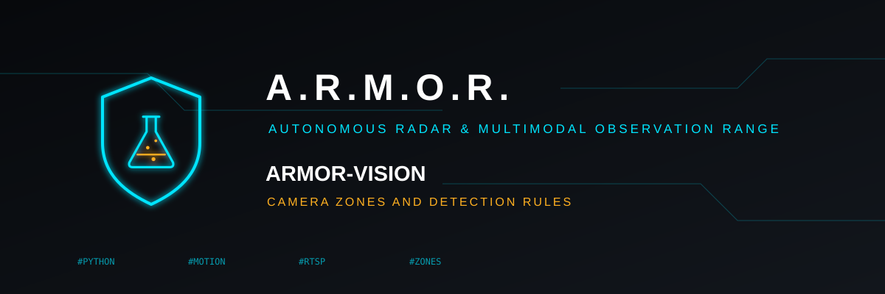
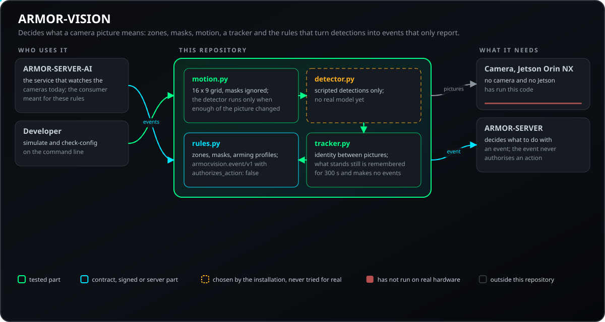
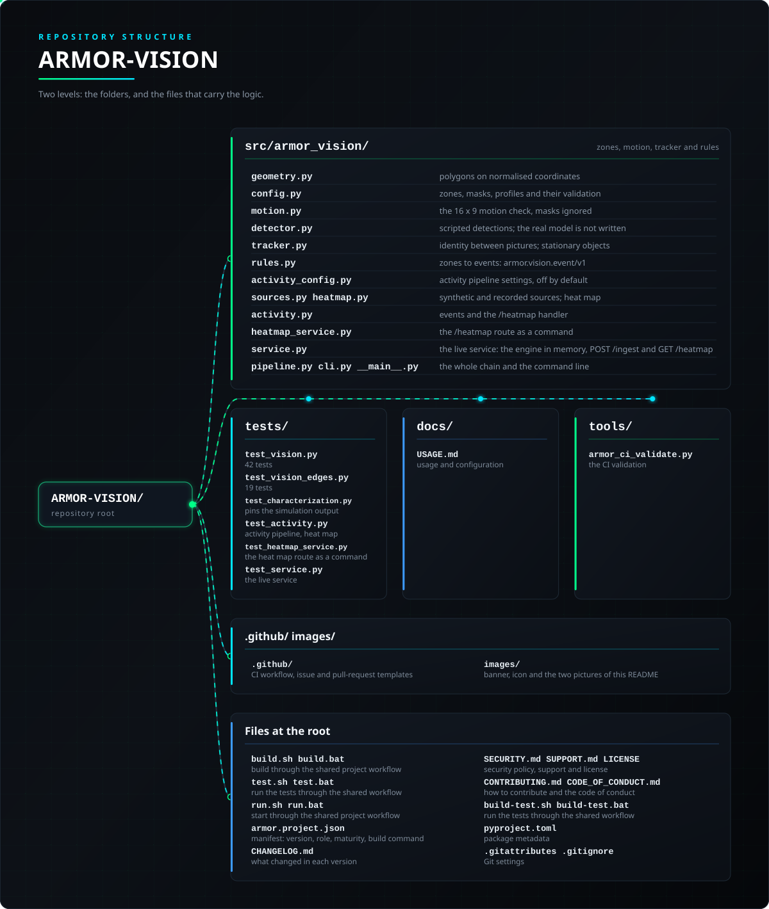

<p align="center">
  
</p>

# 👁️ ARMOR-VISION

<p align="center">
  🇺🇸 <b>English</b> |
  <a href="README_spa.md">🇪🇸 Español</a> |
  <a href="README_fra.md">🇫🇷 Français</a> |
  <a href="README_ita.md">🇮🇹 Italiano</a> |
  <a href="README_deu.md">🇩🇪 Deutsch</a> |
  <a href="README_zho.md">🇨🇳 简体中文</a> |
  <a href="README_jpn.md">🇯🇵 日本語</a> |
  <a href="README_por.md">🇵🇹 Português</a>
</p>

### Zones, masks and detection rules for the cameras

<p align="center">
  
  
  
  
  
  
</p>

---

**Honesty check - what runs today:** The zones, the motion check, the tracker, the rules and the 129 tests are real. There is **no real detector model yet** and nothing has run on a camera or on the Jetson Orin NX: the simulation uses scripted detections.

---

## 📋 At a glance

| | |
|---|---|
| Version | `0.1.0` |
| Maturity | Functional |
| Role | Camera zones, masks and detection rules (family: Core Services, parent: ARMOR-SERVER) |
| Stack | Python 3.11+, standard library only |
| Tests | 129 (`python -m unittest discover -s tests`) |
| Runs on | Any computer |
| On real hardware | None yet: no real detector, camera or Jetson (a simulation with scripted detections) |
| License | GPL-3.0-or-later |

**Jump to:** [Overview](#-overview) · [Architecture](#-architecture) · [Security](#-security--safety) · [Interfaces](#-interfaces) · [Configuration](#-configuration) · [Quick start](#-quick-start) · [Testing](#-testing) · [Troubleshooting](#-troubleshooting) · [Structure](#-repository-structure) · [Related](#-related-projects)

## 🚦 Project status

Each line is one part of this repository and the light says how far it is today. It is written from what the repository can show (tests, builds, runs), not from what is planned.

🟢 Done and verified · 🟡 Works, with known limits · 🟠 Partly done or not verified yet · 🔴 Not done or not working

| Area | State | What it means here |
|---|---|---|
| Software | 🟡 | The zones, the motion check, the tracker and the rules work, but there is no real detector model yet: the simulation uses scripted detections. |
| Tests | 🟢 | 129 tests pass (`python -m unittest discover -s tests`). |
| Hardware | 🔴 | Nothing has run on a camera or on the Jetson Orin NX. |
| Interface | 🟡 | The routes or messages it offers are documented and tested with a client; not every client has used them yet |
| Security | 🟡 | Access control, input limits or signatures are implemented and tested on a computer; nobody outside the project has reviewed them |
| Integration | 🟠 | Its messages are validated against the shared schemas and conformance vectors of ARMOR-COMMON; it has not run together with the real equipment |
| Documentation | 🟢 | Eight languages and the changelog are up to date. |

## 🎯 Overview

* **Zones and masks:** polygons drawn on normalised coordinates (0 to 1), so one drawing works at any resolution; a zone counts detections, a mask ignores movement. Each zone has a label filter, a kind (`alert` or `detection`) and an inertia in pictures and seconds.
* **Motion first:** the expensive detector runs only when enough of the picture, outside the masks, has changed.
* **A tracker:** each object keeps its identity between pictures, and what stands still (a parked car) is remembered and makes no new events.
* **Arming profiles:** `away`, `home` and the like choose which zones are watched; an unknown mode watches everything.
* **Events that only report:** an alert or a detection always carries `authorizes_action: false`; the server decides what to do.

## 🧩 Role in A.R.M.O.R.

ARMOR-VISION is the part that decides what a camera's picture means, apart from any detector: the zones and masks drawn on it, the motion check that runs before the expensive detector, the tracker, the arming profiles and the rules that turn detections into events. [ARMOR-SERVER-AI](https://github.com/JuanenRac/ARMOR-SERVER-AI) is the service that watches the cameras today; ARMOR-VISION is where the rules for a real detection model are ready, waiting for it. It only reports: the events never authorise an action.

| Name | How | What for |
|---|---|---|
| ARMOR-SERVER-AI | same rules, once a model exists | Watches the cameras today |
| ARMOR-SERVER | `armor.vision.event/v1` | Decides what to do with an event (not part of the ARMOR-COMMON contract yet) |

## 🏛️ Architecture

<p align="center">
  
</p>

## 🔒 Security & Safety

| Threat | Defence |
|---|---|
| The rule engine acts on its own | Every event carries `authorizes_action: false` (schema `armor.vision.event/v1`); the server decides |
| A wrong camera configuration | `check-config` lists every problem and one problem means nothing is accepted; coordinates are 0 to 1, a zone is `alert` or `detection`, unknown fields are errors |
| The costly detector runs for nothing | Motion comes first: the detector is asked only when enough cells of the 16 x 9 grid changed outside the masks |
| A parked car raises event after event | The tracker remembers what stands still (drift under 0.01 in 3 s) for 300 s and it makes no new events |
| An unknown arming mode | Every zone is watched; only `disarmed` without a profile silences the `alert` zones, and `detection` zones still record |
| The activity pipeline stores or leaks pictures of people | It is off by default; it keeps only a count per cell of the grid (positions, labels and numbers), never a picture, a box or an identity; the export says `contains_images: false`. A file of detections that is malformed, goes back in time or is over 16 MiB is refused whole, and the map has a hard memory limit |

Nothing here is a safety function: there is no real detector model yet.

## 🔌 Interfaces

| Name | What it sets |
|---|---|
| `python -m armor_vision simulate [--config FILE] [--mode MODE]` | Runs a built-in scenario (a person crossing a driveway, a parked car, movement behind a masked tree) and prints one JSON line per event and a last line with the counters |
| `python -m armor_vision check-config FILE` | Validates a configuration and prints every problem; exit 0 good, 1 invalid, 2 unreadable |
| `python -m armor_vision simulate --simulate-events --activity-config FILE [--seed N] [--detections-file FILE]` | Activity pipeline, OFF unless the file says `"enabled": true` (exit 3 when off): a synthetic scene with a fixed seed, or recorded detections, gives one JSON line per event (`zone_enter`, `zone_exit`, `dwell`, `loiter`, `line_cross`) |
| `python -m armor_vision simulate --heatmap OUT --activity-config FILE` | Writes the heat map of activity (counts per cell, `OUT` ends in `.json`, `.png` or `.svg`); only aggregated positions, never pictures |
| `python -m armor_vision activity-example` / `check-activity-config FILE` | Prints an activity configuration to start from / validates one (exit 0 good, 1 invalid, 2 unreadable) |
| `ActivityEngine`, `heatmap_route` | As a library: the engine and the handler of `GET /heatmap?camera=ID&format=json` (`png` and `svg` too), for the service that mounts it; the route answers 404 while the pipeline is off |
| `python -m armor_vision heatmap-route --activity-config FILE [--detections-file FILE] [--camera ID] [--format json|png|svg] [--scale N]` | Answers one `GET /heatmap` query from recorded detections and prints the answer as one JSON line (`status`, `content_type`, `body_base64`); this is what a server that mounts the route runs. Exit 0 for every answer of the route (also 404 when the pipeline is off and 400 for a bad query), 1 for a wrong configuration, 2 for a file that cannot be read |
| `python -m armor_vision replay FILE [--config FILE] [--mode MODE]` | Runs recorded detections (JSON lines) through the zone rules and prints the events each zone would have raised, with the count per zone (exit 2 for a file that cannot be used or a camera that is not in the configuration) |
| `OnnxDetector`, `parse_onnx_settings` | As a library: a detector that runs an ONNX model on the CPU (needs `onnxruntime`, which is not a dependency; off unless it is built) |
| `python -m armor_vision serve --activity-config FILE [--config FILE] [--service-config FILE]` | Runs the live service: the activity engine stays in memory, detections come in one observation at a time (`POST /ingest`) and `GET /heatmap` answers from that memory. It listens on 127.0.0.1 unless the settings file says `allow_remote`, keeps no secret but the token it may ask for (it must have one, in a file, when it is open to other machines) and stores nothing on disk. Exit 1 for a wrong configuration or an activity pipeline that is off, 2 for a file that cannot be read or a port that cannot be opened Limits in the settings file: `request_timeout_s` (a client that goes quiet is dropped), `max_connections` (the next one is told to come back with 503) and `render_cache_entries` (how many drawn maps are kept; 0 turns it off). |

```json
{"schema": "armor.vision.event/v1", "type": "alert", "camera_id": "cam-front", "zone_id": "drive",
 "zone_name": "Driveway", "track_id": 1, "label": "person", "confidence": 0.9,
 "box": [0.41, 0.62, 0.47, 0.82], "timestamp": 1.0, "authorizes_action": false}
```

As a library: `parse_config`, `Pipeline.process_detections` and `process_frame`. Asking `load_detector("tensorrt")` raises `DetectorUnavailable` because the model for the Jetson Orin NX is not written. See [docs/USAGE.md](docs/USAGE.md).

## ⚙️ Configuration

| Name | What it sets |
|---|---|
| `motion_threshold` | 1 to 255: the grey difference that counts as change |
| `motion_min_cells` | How many cells of the 16 x 9 grid must change before the detector is asked |
| `zones[]` | `id`, `name`, `kind` (`alert` or `detection`), `labels`, `min_frames`, `min_seconds`, `points` (polygon, 0 to 1); counted by the feet of the box |
| `masks[]` | Polygons where movement is ignored; detections whose centre is inside are dropped |
| `profiles` | Which zones are watched in each arming mode (`away`, `home`, ...) |
| `activity configuration (separate file)` | `enabled` (default `false`), `heatmap` (`cols`, `rows`, `window_seconds`, `half_life_seconds`, `slices`, `max_cells` up to 65536, `position`, `labels`) and `events` (`dwell_seconds`, `loiter_seconds`, `loiter_radius`, `lost_seconds`, `labels`, `lines[]` with `id`, `a`, `b`); the heat map is normalised as weight divided by the maximum |

| Limit | Value |
|---|---|
| Matching of a detection to a track (overlap / reach) | 0.3 / 1.0 |
| A moving track not seen is dropped after | 2 s |
| Stationary: window / drift / remembered for | 3 s / 0.01 / 300 s |
| Motion grid | 16 x 9 |

These values are constants of `tracker.py` and `motion.py` today; the configuration file holds the zones, masks, profiles and the motion thresholds.

## 🚀 Quick start

**Requirements:** Python 3.11+ (standard library only).

```powershell
$env:PYTHONPATH = "src"
python -m armor_vision simulate --mode away
python -m armor_vision check-config my_cameras.json
python -m unittest discover -s tests   # 129 tests
```

```bash
PYTHONPATH=src python -m armor_vision simulate --mode away
PYTHONPATH=src python -m armor_vision check-config my_cameras.json
PYTHONPATH=src python -m unittest discover -s tests   # 129 tests
```

## 🧪 Testing

```powershell
$env:PYTHONPATH = "src"
python -m unittest discover -s tests
python -I tools/armor_ci_validate.py
```

| Test file | Tests | What it covers |
|---|---|---|
| `test_vision.py` | 42 | Geometry, configuration, motion, tracker, rules, profiles, the pipeline and the command line |
| `test_vision_edges.py` | 19 | The edges: bad configurations, stationary objects, masked detections and the unavailable detector |
| `test_characterization.py` | 2 | Fixes the output of the built-in simulation byte for byte, so that it cannot change while the activity pipeline is off |
| `test_activity.py` | 27 | Activity configuration, synthetic and recorded sources, events, heat map (determinism, sum equals detections, nothing outside the grid, window, decay, memory), the `/heatmap` handler and the command line |
| `test_heatmap_service.py` | 7 | The heat map route as a command: off is 404 whatever the data, on with no data is an empty map, counts in the three formats, bad queries, and a wrong configuration or file is an error and never an empty map |
| `test_service.py` | 15 | The live service: the same map as the replayed file, off is 404 and 503, what is not understood is refused, the limits of the settings, bounded memory and the command |
| `test_service_load.py` | 7 | The live service under light load and with clients that misbehave: the new limits and their ranges, a client that goes quiet is dropped, the requests at once are bounded, exact counters under many threads, the drawing of an unchanged map is reused and bounded, and a map being drawn does not hold up the observations |

## 🏗️ Build & Release

It is plain Python: nothing to compile. The version lives in `pyproject.toml` and `armor.project.json`.

## 🩺 Troubleshooting

| You see | Because | Do |
|---|---|---|
| `check-config` exits with 1 | The configuration has problems; it lists each one | Fix them all: unknown fields are errors |
| `check-config` exits with 2 | The file cannot be read | Check the path and that it is JSON |
| `DetectorUnavailable` | `load_detector("tensorrt")`: the real model is not written | Use `ScriptedDetector` |
| A zone never fires | The feet are outside the polygon, the label is not accepted, a mask hides it, or the mode has no profile with that zone | Run `simulate` with the same file and mode |

## 📂 Repository Structure

<p align="center">
  
</p>

<details>
<summary>Text version of the tree</summary>

```text
ARMOR-VISION/
├── src/armor_vision/
│   ├── geometry.py                      polygons on normalised coordinates
│   ├── config.py                        zones, masks, profiles and their validation
│   ├── motion.py                        the 16 x 9 motion check, masks ignored
│   ├── detector.py                      scripted detections; the real model is not written
│   ├── tracker.py                       identity between pictures; stationary objects
│   ├── rules.py                         zones to events: armor.vision.event/v1
│   ├── activity_config.py               activity pipeline settings, off by default
│   ├── sources.py heatmap.py            synthetic and recorded sources; heat map
│   ├── activity.py                      events and the /heatmap handler
│   ├── heatmap_service.py               the /heatmap route as a command
│   ├── service.py                       the live service: the engine in memory, POST /ingest and GET /heatmap
│   └── pipeline.py cli.py __main__.py   the whole chain and the command line
├── tests/                               the tests
├── docs/                                the guides of this repository
├── tools/                               the shared CI checks and project tooling
├── .github/                             CI workflow, issue and pull-request templates
├── images/                              banner, icon and the two pictures of this README
├── build.sh build.bat                   build through the shared project workflow
├── test.sh test.bat                     run the tests through the shared workflow
├── run.sh run.bat                       start through the shared project workflow
├── armor.project.json                   manifest: version, role, maturity, build command
├── CHANGELOG.md                         what changed in each version
├── SECURITY.md SUPPORT.md LICENSE       security policy, support and license
├── CONTRIBUTING.md CODE_OF_CONDUCT.md   how to contribute and the code of conduct
├── build-test.sh build-test.bat         run the tests through the shared workflow
├── pyproject.toml                       package metadata
└── .gitattributes .gitignore            Git settings
```

</details>

## 🗺️ Roadmap & Known limits

**Known limits today**

* There is no real detector model yet, and nothing has run on a camera or on the Jetson Orin NX: the simulation uses scripted detections.
* The camera or RTSP source of the activity pipeline is for the hardware and is not written: today it runs on a synthetic scene or a file of detections. The heat map has no HTTP server here, only the handler.
* The event is not part of the ARMOR-COMMON contract yet.
* The tracker and motion values are constants in the code, not in the configuration file.

**Next**

* Write the detector model for the Jetson Orin NX and try it with a real camera.
* Move the tracker and motion constants to the configuration file and put the event in the ARMOR-COMMON contract.

## 🌍 Languages

README and texts exist in English, Spanish, French, Italian, German, Chinese, Japanese and European Portuguese.

## 🔗 Related Projects

**A.R.M.O.R.** (Autonomous Radar & Multimodal Observation Range) is a perimeter-security system made of independent repositories. Each one has its own version, its own tests and its own README; this is the family:

* **[ARMOR-COMMON](https://github.com/JuanenRac/ARMOR-COMMON)** - Message contracts, validators, conformance vectors and generated types
* **[ARMOR-NODE-RADAR](https://github.com/JuanenRac/ARMOR-NODE-RADAR)** - Field-node firmware for ESP32-S3 with three radars and its own web panel
* **[ARMOR-NODE-SOLAR](https://github.com/JuanenRac/ARMOR-NODE-SOLAR)** - Solar inverter and battery protocols and the messages of a gateway node
* **[ARMOR-NODE-ELECTRICAL](https://github.com/JuanenRac/ARMOR-NODE-ELECTRICAL)** - Electrical node: meters, the message of the network's readings and the rules for switching
* **[ARMOR-NODE-ALARM](https://github.com/JuanenRac/ARMOR-NODE-ALARM)** - Alarm node and panel: zones, arming, delays, siren and PIN, with the server or without it
* **[ARMOR-NODE-HMI](https://github.com/JuanenRac/ARMOR-NODE-HMI)** - Touch panel: the state of the system on a wall screen, arming and acknowledging, and the home of the voice assistant
* **[ARMOR-NETWORK](https://github.com/JuanenRac/ARMOR-NETWORK)** - The local network: its devices, the internet and what changes
* **[ARMOR-SERVER](https://github.com/JuanenRac/ARMOR-SERVER)** - Central coordinator: telemetry, alarms, devices, solar readings and cameras
* **[ARMOR-STUDIO](https://github.com/JuanenRac/ARMOR-STUDIO)** - Web console: cameras, radar, alarms, solar energy and the 2D/3D site designer
* **[ARMOR-ANDROID-CONTROL](https://github.com/JuanenRac/ARMOR-ANDROID-CONTROL)** - Android operator client with a live 2D/3D radar
* **[ARMOR-IOS-CONTROL](https://github.com/JuanenRac/ARMOR-IOS-CONTROL)** - iPhone operator client
* **[ARMOR-SERVER-AI](https://github.com/JuanenRac/ARMOR-SERVER-AI)** - Visual inference policy that explains its decisions and never actuates
* **ARMOR-VISION** (this repository) - Camera zones, masks and detection rules for the Jetson Orin NX
* **[ARMOR-VOICE-AI](https://github.com/JuanenRac/ARMOR-VOICE-AI)** - Offline voice intents with a confirmation that cannot be forged
* **[ARMOR-HARDWARE](https://github.com/JuanenRac/ARMOR-HARDWARE)** - Enclosures, electronics and the bench acceptance matrix
* **[ARMOR-DEVOPS](https://github.com/JuanenRac/ARMOR-DEVOPS)** - Deployment, the CM5 test bench, backup and TLS
* **[ARMOR-SIMULATOR](https://github.com/JuanenRac/ARMOR-SIMULATOR)** - Offline telemetry simulator with repeatable faults
* **[ARMOR-UPDATER](https://github.com/JuanenRac/ARMOR-UPDATER)** - Detects, installs and updates the ecosystem's own repositories
* **[ARMOR-DOCS](https://github.com/JuanenRac/ARMOR-DOCS)** - Architecture, security baseline and the capability matrix

## 📚 Documentation

* [Usage](docs/USAGE.md): the commands, the configuration, the event and the library
* [Capability matrix: what is proven and what is not](https://github.com/JuanenRac/ARMOR-DOCS/blob/main/docs/CAPABILITY_MATRIX.md)
* [Project catalogue: versions and how the repositories depend on each other](https://github.com/JuanenRac/ARMOR-DOCS/blob/main/docs/PROJECT_CATALOG.md)
* [Changelog of this repository](CHANGELOG.md)

## 🤝 Contributing & Community

* Before a pull request run `python -m unittest discover -s tests` and `python -I tools/armor_ci_validate.py`: it must pass. See [CONTRIBUTING.md](CONTRIBUTING.md) and the [code of conduct](CODE_OF_CONDUCT.md).
* The README exists in eight languages and is generated from the sources in ARMOR-DOCS: a change to the text is made there.
* A change to a message between components starts in ARMOR-COMMON.
* Do not describe as working on a board what has only been built.
* Report a vulnerability privately: [SECURITY.md](SECURITY.md). Questions, ideas and reports: electrohobby3d@gmail.com ([SUPPORT.md](SUPPORT.md)).

## 👤 AUTHOR

**JuanenRac (Electro Hobby 3D)** · electrohobby3d@gmail.com

## 📜 LICENSE

GPL-3.0-or-later - see [LICENSE](LICENSE).
