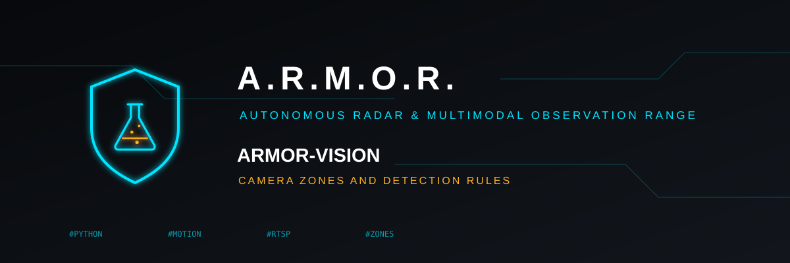

<p align="center">
  
</p>

# 👁️ ARMOR-VISION

<p align="center">
  <a href="README.md">🇺🇸 English</a> |
  <a href="README_spa.md">🇪🇸 Español</a> |
  <a href="README_fra.md">🇫🇷 Français</a> |
  🇮🇹 <b>Italiano</b> |
  <a href="README_deu.md">🇩🇪 Deutsch</a> |
  <a href="README_zho.md">🇨🇳 简体中文</a> |
  <a href="README_jpn.md">🇯🇵 日本語</a> |
  <a href="README_por.md">🇵🇹 Português</a>
</p>

### Zone, maschere e regole di rilevamento per le telecamere

<p align="center">
  
  
  
  
  
  
</p>

---

**Controllo di onestà - cosa funziona oggi:** Le zone, il controllo del movimento, il tracciamento, le regole e i 42 test sono reali. **Non esiste ancora un vero modello di rilevamento** e nulla è stato eseguito su una telecamera o sulla Jetson Orin NX: la simulazione usa rilevamenti scriptati.

---

## 📋 In breve

| | |
|---|---|
| Versione | `0.0.2` |
| Maturità | Funzionale |
| Test | 42 (`python -m unittest discover -s tests`) |
| Tecnologia | Python 3.11+ |
| Su hardware reale | Ancora nessuno: né rilevatore reale, né telecamera, né Jetson (una simulazione con rilevamenti scriptati) |

## 🎯 Panoramica

* **Zone e maschere:** poligoni disegnati in coordinate normalizzate (da 0 a 1), così lo stesso disegno vale a qualsiasi risoluzione; una zona conta i rilevamenti, una maschera ignora il movimento. Ogni zona ha un filtro di etichette, un tipo (`alert` o `detection`) e un'inerzia in immagini e secondi.
* **Prima il movimento:** il rilevatore, costoso, viene eseguito solo quando è cambiata abbastanza immagine fuori dalle maschere.
* **Un tracciamento:** ogni oggetto mantiene la sua identità da un'immagine all'altra, e ciò che sta fermo (un'auto parcheggiata) viene ricordato e non genera nuovi eventi.
* **Profili di inserimento:** `away`, `home` e simili scelgono quali zone sono sorvegliate; una modalità sconosciuta sorveglia tutto.
* **Eventi che informano soltanto:** un allarme o un rilevamento porta sempre `authorizes_action: false`; il server decide cosa fare.

## 🧩 Ruolo in A.R.M.O.R.

ARMOR-VISION è la parte che decide cosa significa l'immagine di una telecamera, a prescindere da qualsiasi rilevatore: le zone e le maschere disegnate su di essa, il controllo di movimento che gira prima del rilevatore costoso, il tracker, i profili di inserimento e le regole che trasformano i rilevamenti in eventi. [ARMOR-SERVER-AI](https://github.com/JuanenRac/ARMOR-SERVER-AI) è il servizio che oggi sorveglia le telecamere; ARMOR-VISION è dove le regole per un vero modello di rilevamento sono pronte, in attesa. Si limita a riferire: gli eventi non autorizzano mai un'azione.

## 📂 Struttura del repository

```text
ARMOR-VISION/
├── src/armor_vision/   geometry, config (zones, masks, profiles), motion, tracker, rules, detector, pipeline, cli
├── tests/              42 tests
└── docs/USAGE.md
```

## 🛠️ Ambiente di sviluppo

**Requisiti:** Python 3.11+ (standard library only)

```powershell
$env:PYTHONPATH="src"
python -m armor_vision simulate --mode away
python -m armor_vision check-config my_cameras.json
python -m unittest discover -s tests   # 42 tests
```

Opzioni e formato della configurazione: [uso](docs/USAGE.md).

## 🔗 Progetti correlati

**A.R.M.O.R.** (Autonomous Radar & Multimodal Observation Range) è un sistema di sicurezza perimetrale fatto di repository indipendenti. Ognuno ha la propria versione, i propri test e il proprio README; ecco la famiglia:

* **[ARMOR-COMMON](https://github.com/JuanenRac/ARMOR-COMMON)** - Contratti dei messaggi, validatori, vettori di conformità e tipi generati
* **[ARMOR-RADAR](https://github.com/JuanenRac/ARMOR-RADAR)** - Firmware del nodo di campo per ESP32-S3 con tre radar e un proprio pannello web
* **[ARMOR-SOLAR](https://github.com/JuanenRac/ARMOR-SOLAR)** - Protocolli di inverter e batterie solari e messaggi di un nodo gateway
* **[ARMOR-ELECTRICAL](https://github.com/JuanenRac/ARMOR-ELECTRICAL)** - Nodo elettrico: contatori, il messaggio delle letture della rete e le regole di manovra
* **[ARMOR-ALARM](https://github.com/JuanenRac/ARMOR-ALARM)** - Nodo e centrale d'allarme: zone, inserimento, ritardi, sirena e PIN, con il server o senza
* **[ARMOR-HMI](https://github.com/JuanenRac/ARMOR-HMI)** - Pannello touch: lo stato del sistema su uno schermo a parete, attivare e riconoscere gli allarmi, e la casa dell'assistente vocale
* **[ARMOR-NETWORK](https://github.com/JuanenRac/ARMOR-NETWORK)** - La rete locale: i suoi dispositivi, internet e ciò che cambia
* **[ARMOR-SERVER](https://github.com/JuanenRac/ARMOR-SERVER)** - Coordinatore centrale: telemetria, allarmi, dispositivi, letture solari e telecamere
* **[ARMOR-STUDIO](https://github.com/JuanenRac/ARMOR-STUDIO)** - Console web: telecamere, radar, allarmi, energia solare e progettista del sito 2D/3D
* **[ARMOR-ANDROID-CONTROL](https://github.com/JuanenRac/ARMOR-ANDROID-CONTROL)** - Client Android dell'operatore con radar 2D/3D in tempo reale
* **[ARMOR-SERVER-AI](https://github.com/JuanenRac/ARMOR-SERVER-AI)** - Politica di inferenza visiva che spiega le sue decisioni e non agisce mai
* **ARMOR-VISION** (questo repository) - Zone delle telecamere, maschere e regole di rilevamento per la Jetson Orin NX
* **[ARMOR-VOICE-AI](https://github.com/JuanenRac/ARMOR-VOICE-AI)** - Intenti vocali offline con una conferma impossibile da falsificare
* **[ARMOR-HARDWARE](https://github.com/JuanenRac/ARMOR-HARDWARE)** - Contenitori, elettronica e matrice di accettazione da banco
* **[ARMOR-DEVOPS](https://github.com/JuanenRac/ARMOR-DEVOPS)** - Distribuzione, banco di prova CM5, backup e TLS
* **[ARMOR-SIMULATOR](https://github.com/JuanenRac/ARMOR-SIMULATOR)** - Simulatore di telemetria offline con guasti ripetibili
* **[ARMOR-UPDATER](https://github.com/JuanenRac/ARMOR-UPDATER)** - Rileva, installa e aggiorna i repository stessi dell'ecosistema
* **[ARMOR-DOCS](https://github.com/JuanenRac/ARMOR-DOCS)** - Architettura, base di sicurezza e matrice delle capacità

## 📚 Documentazione e comunità

Dove leggere di più:

* [Matrice delle capacità: cosa è provato e cosa no](https://github.com/JuanenRac/ARMOR-DOCS/blob/main/docs/CAPABILITY_MATRIX.md)
* [Catalogo dei progetti: versioni e dipendenze tra i repository](https://github.com/JuanenRac/ARMOR-DOCS/blob/main/docs/PROJECT_CATALOG.md)
* [Cronologia delle modifiche di questo repository](CHANGELOG.md)
* [Licenza (GPL-3.0-or-later)](LICENSE)
* Domande, idee e segnalazioni: electrohobby3d@gmail.com

## 👤 AUTORE

**JuanenRac (Electro Hobby 3D)** · electrohobby3d@gmail.com

## 📜 LICENZA

GPL-3.0-or-later - vedi [LICENSE](LICENSE).
