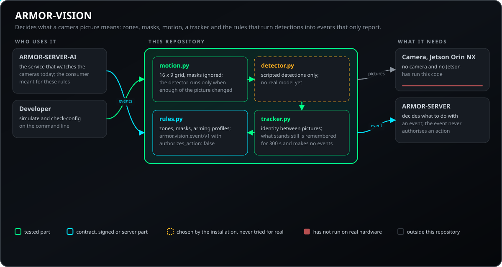
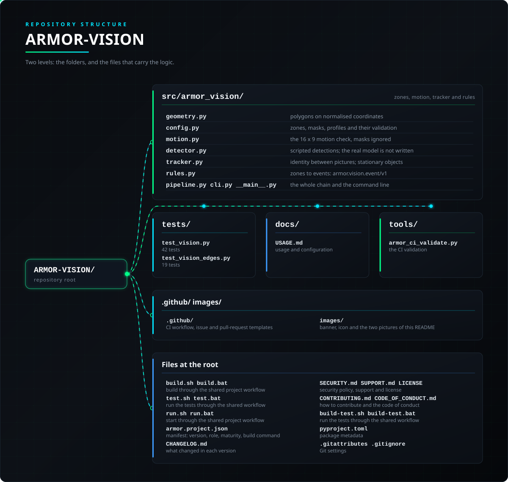

<p align="center">
  
</p>

# 👁️ ARMOR-VISION

<p align="center">
  <a href="README.md">🇺🇸 English</a> |
  <a href="README_spa.md">🇪🇸 Español</a> |
  <a href="README_fra.md">🇫🇷 Français</a> |
  <a href="README_ita.md">🇮🇹 Italiano</a> |
  <a href="README_deu.md">🇩🇪 Deutsch</a> |
  <a href="README_zho.md">🇨🇳 简体中文</a> |
  <a href="README_jpn.md">🇯🇵 日本語</a> |
  🇵🇹 <b>Português</b>
</p>

### Zonas, máscaras e regras de deteção para as câmaras

<p align="center">
  
  
  
  
  
  
</p>

---

**Verificação de honestidade - o que funciona hoje:** As zonas, a verificação de movimento, o seguidor, as regras e os 61 testes são reais. **Ainda não há nenhum modelo detetor real** e nada correu numa câmara nem no Jetson Orin NX: a simulação usa deteções com guião.

---

## 📋 Num relance

| | |
|---|---|
| Versão | `0.0.3` |
| Maturidade | Funcional |
| Função | Zonas, máscaras e regras de deteção de câmaras (família: Core Services, pai: ARMOR-SERVER) |
| Tecnologia | Python 3.11+, só biblioteca padrão |
| Testes | 61 (`python -m unittest discover -s tests`) |
| Funciona em | Qualquer computador |
| Em hardware real | Nenhum ainda: nem detetor real, nem câmara, nem Jetson (uma simulação com deteções guionizadas) |
| Licença | GPL-3.0-or-later |

**Ir para:** [Visão geral](#-visão-geral) · [Arquitetura](#-arquitetura) · [Segurança](#-segurança-e-proteção) · [Interfaces](#-interfaces) · [Configuração](#-configuração) · [Início rápido](#-início-rápido) · [Testes](#-testes) · [Problemas](#-resolução-de-problemas) · [Estrutura](#-estrutura-do-repositório) · [Relacionados](#-projetos-relacionados)

## 🚦 Estado do projeto

Cada linha é uma parte deste repositório e a luz diz até onde chega hoje. É escrita com o que o repositório consegue demonstrar (testes, compilações, execuções), não com o que está previsto.

🟢 Feito e verificado · 🟡 Funciona, com limites conhecidos · 🟠 Feito a meio ou ainda por verificar · 🔴 Por fazer ou a não funcionar

| Área | Estado | O que significa aqui |
|---|---|---|
| Software | 🟡 | As zonas, a verificação de movimento, o seguimento e as regras funcionam, mas ainda não há um modelo detetor real: a simulação usa deteções com guião. |
| Testes | 🟢 | Passam 61 testes (`python -m unittest discover -s tests`). |
| Hardware | 🔴 | Nada funcionou numa câmara nem no Jetson Orin NX. |
| Documentação | 🟢 | Oito idiomas e o registo de alterações estão atualizados. |

## 🎯 Visão geral

* **Zonas e máscaras:** polígonos desenhados em coordenadas normalizadas (0 a 1), para que um só desenho funcione em qualquer resolução; uma zona conta deteções, uma máscara ignora o movimento. Cada zona tem um filtro de etiquetas, um tipo (`alert` ou `detection`) e uma inércia em imagens e segundos.
* **Primeiro o movimento:** o detetor caro só corre quando mudou o suficiente da imagem, fora das máscaras.
* **Um seguidor:** cada objeto mantém a sua identidade entre imagens, e o que está parado (um carro estacionado) é lembrado e não gera eventos novos.
* **Perfis de armação:** `away`, `home` e semelhantes escolhem que zonas se vigiam; um modo desconhecido vigia tudo.
* **Eventos que só reportam:** um alerta ou uma deteção leva sempre `authorizes_action: false`; o servidor decide o que fazer.

## 🧩 Papel no A.R.M.O.R.

O ARMOR-VISION é a parte que decide o que significa a imagem de uma câmara, à parte de qualquer detetor: as zonas e máscaras desenhadas nela, a verificação de movimento que corre antes do detetor dispendioso, o seguidor, os perfis de armar e as regras que transformam deteções em eventos. O [ARMOR-SERVER-AI](https://github.com/JuanenRac/ARMOR-SERVER-AI) é o serviço que hoje vigia as câmaras; o ARMOR-VISION é onde as regras para um modelo de deteção real estão prontas, à sua espera. Só comunica: os eventos nunca autorizam uma ação.

| Nome | Como | Para quê |
|---|---|---|
| ARMOR-SERVER-AI | as mesmas regras, quando houver um modelo | Hoje vigia as câmaras |
| ARMOR-SERVER | `armor.vision.event/v1` | Decide o que fazer com um evento (ainda fora do contrato do ARMOR-COMMON) |

## 🏛️ Arquitetura

<p align="center">
  
</p>

## 🔒 Segurança e proteção

| Ameaça | Defesa |
|---|---|
| O motor de regras age por conta própria | Todo o evento leva `authorizes_action: false` (esquema `armor.vision.event/v1`); quem decide é o servidor |
| Uma configuração de câmara errada | `check-config` lista todos os problemas e basta um para nada ser aceite; as coordenadas vão de 0 a 1, uma zona é `alert` ou `detection`, os campos desconhecidos são erros |
| O detetor caro corre sem motivo | Primeiro o movimento: o detetor só é consultado se células suficientes da grelha 16 x 9 mudarem fora das máscaras |
| Um carro estacionado gera evento após evento | O seguimento lembra o que está parado (deriva abaixo de 0,01 em 3 s) durante 300 s e não gera eventos novos |
| Um modo de armação desconhecido | Vigiam-se todas as zonas; só `disarmed` sem perfil silencia as zonas `alert` e as `detection` continuam a registar |

Nada aqui é uma função de segurança: ainda não há um modelo de deteção real.

## 🔌 Interfaces

| Nome | O que define |
|---|---|
| `python -m armor_vision simulate [--config FILE] [--mode MODE]` | Executa um cenário integrado (uma pessoa atravessa um acesso, um carro estacionado, movimento atrás de uma árvore mascarada) e imprime uma linha JSON por evento e uma última com os contadores |
| `python -m armor_vision check-config FILE` | Valida uma configuração e imprime cada problema; saída 0 boa, 1 inválida, 2 ilegível |

```json
{"schema": "armor.vision.event/v1", "type": "alert", "camera_id": "cam-front", "zone_id": "drive",
 "zone_name": "Driveway", "track_id": 1, "label": "person", "confidence": 0.9,
 "box": [0.41, 0.62, 0.47, 0.82], "timestamp": 1.0, "authorizes_action": false}
```

Como biblioteca: `parse_config`, `Pipeline.process_detections` e `process_frame`. Pedir `load_detector("tensorrt")` lança `DetectorUnavailable` porque o modelo para o Jetson Orin NX não está escrito. Consulte [docs/USAGE.md](docs/USAGE.md).

## ⚙️ Configuração

| Nome | O que define |
|---|---|
| `motion_threshold` | 1 a 255: a diferença de cinzento que conta como mudança |
| `motion_min_cells` | Quantas células da grelha 16 x 9 têm de mudar antes de consultar o detetor |
| `zones[]` | `id`, `name`, `kind` (`alert` ou `detection`), `labels`, `min_frames`, `min_seconds`, `points` (polígono, 0 a 1); conta-se pelos pés da caixa |
| `masks[]` | Polígonos onde o movimento é ignorado; as deteções com o centro lá dentro são descartadas |
| `profiles` | Que zonas são vigiadas em cada modo de armação (`away`, `home`, ...) |

| Limite | Valor |
|---|---|
| Emparelhamento de uma deteção com uma pista (sobreposição / alcance) | 0.3 / 1.0 |
| Uma pista em movimento não vista é descartada após | 2 s |
| Parado: janela / deriva / lembrado durante | 3 s / 0.01 / 300 s |
| Grelha de movimento | 16 x 9 |

Estes valores são hoje constantes de `tracker.py` e `motion.py`; o ficheiro de configuração contém as zonas, máscaras, perfis e os limiares de movimento.

## 🚀 Início rápido

**Requisitos:** Python 3.11+ (só biblioteca padrão).

```powershell
$env:PYTHONPATH = "src"
python -m armor_vision simulate --mode away
python -m armor_vision check-config my_cameras.json
python -m unittest discover -s tests   # 61 tests
```

```bash
PYTHONPATH=src python -m armor_vision simulate --mode away
PYTHONPATH=src python -m armor_vision check-config my_cameras.json
PYTHONPATH=src python -m unittest discover -s tests   # 61 tests
```

## 🧪 Testes

```powershell
$env:PYTHONPATH = "src"
python -m unittest discover -s tests
python -I tools/armor_ci_validate.py
```

| Ficheiro de testes | Testes | O que cobre |
|---|---|---|
| `test_vision.py` | 42 | Geometria, configuração, movimento, seguimento, regras, perfis, a cadeia e a linha de comandos |
| `test_vision_edges.py` | 19 | Os casos-limite: configurações erradas, objetos parados, deteções mascaradas e o detetor indisponível |

## 🏗️ Compilação e publicação

É Python puro: nada a compilar. A versão está em `pyproject.toml` e `armor.project.json`.

## 🩺 Resolução de problemas

| Vê | Porque | Faça |
|---|---|---|
| `check-config` termina com 1 | A configuração tem problemas; lista-os todos | Corrija-os todos: os campos desconhecidos são erros |
| `check-config` termina com 2 | Não é possível ler o ficheiro | Verifique o caminho e que é JSON |
| `DetectorUnavailable` | `load_detector("tensorrt")`: o modelo real não está escrito | Use `ScriptedDetector` |
| Uma zona nunca dispara | Os pés estão fora do polígono, a etiqueta não é aceite, uma máscara esconde-a, ou o modo não tem um perfil com essa zona | Execute `simulate` com o mesmo ficheiro e modo |

## 📂 Estrutura do repositório

<p align="center">
  
</p>

<details>
<summary>Versão em texto da árvore</summary>

```text
ARMOR-VISION/
├── src/armor_vision/
│   ├── geometry.py                      polígonos em coordenadas normalizadas
│   ├── config.py                        zonas, máscaras, perfis e a sua validação
│   ├── motion.py                        a verificação de movimento 16 x 9, máscaras ignoradas
│   ├── detector.py                      deteções guionizadas; o modelo real não está escrito
│   ├── tracker.py                       identidade entre imagens; objetos parados
│   ├── rules.py                         das zonas aos eventos: armor.vision.event/v1
│   └── pipeline.py cli.py __main__.py   toda a cadeia e a linha de comandos
├── tests/                               os testes
├── docs/                                os guias deste repositório
├── tools/                               as verificações de CI partilhadas e as ferramentas do projeto
├── .github/                             fluxo de CI e modelos de issues e pull requests
├── images/                              faixa, ícone e as duas imagens deste README
├── build.sh build.bat                   compilar pelo fluxo de projeto partilhado
├── test.sh test.bat                     executar os testes pelo fluxo partilhado
├── run.sh run.bat                       arrancar pelo fluxo de projeto partilhado
├── armor.project.json                   manifesto: versão, função, maturidade, comando de build
├── CHANGELOG.md                         o que mudou em cada versão
├── SECURITY.md SUPPORT.md LICENSE       política de segurança, apoio e licença
├── CONTRIBUTING.md CODE_OF_CONDUCT.md   como contribuir e o código de conduta
├── build-test.sh build-test.bat         executar os testes pelo fluxo partilhado
├── pyproject.toml                       metadados do pacote
└── .gitattributes .gitignore            definições do Git
```

</details>

## 🗺️ Roteiro e limites conhecidos

**Limites conhecidos hoje**

* Ainda não há um modelo de deteção real e nada correu numa câmara nem no Jetson Orin NX: a simulação usa deteções guionizadas.
* O evento ainda não faz parte do contrato do ARMOR-COMMON.
* Os valores do seguimento e do movimento são constantes no código, não no ficheiro de configuração.

**A seguir**

* Escrever o modelo de deteção para o Jetson Orin NX e experimentá-lo com uma câmara real.
* Passar as constantes do seguimento e do movimento para o ficheiro de configuração e pôr o evento no contrato do ARMOR-COMMON.

## 🌍 Idiomas

O README e os textos existem em inglês, espanhol, francês, italiano, alemão, chinês, japonês e português europeu.

## 🔗 Projetos relacionados

O **A.R.M.O.R.** (Autonomous Radar & Multimodal Observation Range) é um sistema de segurança perimetral feito de repositórios independentes. Cada um tem a sua própria versão, os seus próprios testes e o seu próprio README; esta é a família:

* **[ARMOR-COMMON](https://github.com/JuanenRac/ARMOR-COMMON)** - Contratos de mensagens, validadores, vetores de conformidade e tipos gerados
* **[ARMOR-NODE-RADAR](https://github.com/JuanenRac/ARMOR-NODE-RADAR)** - Firmware de nó de campo para ESP32-S3 com três radares e o seu próprio painel web
* **[ARMOR-NODE-SOLAR](https://github.com/JuanenRac/ARMOR-NODE-SOLAR)** - Protocolos de inversores e baterias solares e as mensagens de um nó porta de ligação
* **[ARMOR-NODE-ELECTRICAL](https://github.com/JuanenRac/ARMOR-NODE-ELECTRICAL)** - Nó elétrico: contadores, a mensagem das leituras da rede e as regras de comutação
* **[ARMOR-NODE-ALARM](https://github.com/JuanenRac/ARMOR-NODE-ALARM)** - Nó e painel de alarme: zonas, armar, atrasos, sirene e PIN, com o servidor ou sem ele
* **[ARMOR-NODE-HMI](https://github.com/JuanenRac/ARMOR-NODE-HMI)** - Painel tátil: o estado do sistema num ecrã de parede, armar e reconhecer, e a casa do assistente de voz
* **[ARMOR-NETWORK](https://github.com/JuanenRac/ARMOR-NETWORK)** - A rede local: os seus dispositivos, a internet e o que muda
* **[ARMOR-SERVER](https://github.com/JuanenRac/ARMOR-SERVER)** - Coordenador central: telemetria, alarmes, dispositivos, leituras solares e câmaras
* **[ARMOR-STUDIO](https://github.com/JuanenRac/ARMOR-STUDIO)** - Consola web: câmaras, radar, alarmes, energia solar e o desenhador 2D/3D do local
* **[ARMOR-ANDROID-CONTROL](https://github.com/JuanenRac/ARMOR-ANDROID-CONTROL)** - Cliente de operador Android com radar 2D/3D em direto
* **[ARMOR-IOS-CONTROL](https://github.com/JuanenRac/ARMOR-IOS-CONTROL)** - Cliente de operador para iPhone
* **[ARMOR-SERVER-AI](https://github.com/JuanenRac/ARMOR-SERVER-AI)** - Política de inferência visual que explica as suas decisões e nunca atua
* **ARMOR-VISION** (este repositório) - Zonas de câmara, máscaras e regras de deteção para o Jetson Orin NX
* **[ARMOR-VOICE-AI](https://github.com/JuanenRac/ARMOR-VOICE-AI)** - Intenções de voz offline com uma confirmação que não pode ser falsificada
* **[ARMOR-HARDWARE](https://github.com/JuanenRac/ARMOR-HARDWARE)** - Caixas, eletrónica e a matriz de aceitação em bancada
* **[ARMOR-DEVOPS](https://github.com/JuanenRac/ARMOR-DEVOPS)** - Implantação, a bancada de testes do CM5, cópias de segurança e TLS
* **[ARMOR-SIMULATOR](https://github.com/JuanenRac/ARMOR-SIMULATOR)** - Simulador de telemetria offline com falhas repetíveis
* **[ARMOR-UPDATER](https://github.com/JuanenRac/ARMOR-UPDATER)** - Deteta, instala e atualiza os repositórios do próprio ecossistema
* **[ARMOR-DOCS](https://github.com/JuanenRac/ARMOR-DOCS)** - Arquitetura, base de segurança e a matriz de capacidades

## 📚 Documentação

* [Utilização](docs/USAGE.md): os comandos, a configuração, o evento e a biblioteca
* [Matriz de capacidades: o que está demonstrado e o que não está](https://github.com/JuanenRac/ARMOR-DOCS/blob/main/docs/CAPABILITY_MATRIX.md)
* [Catálogo de projetos: versões e como os repositórios dependem uns dos outros](https://github.com/JuanenRac/ARMOR-DOCS/blob/main/docs/PROJECT_CATALOG.md)
* [Registo de alterações deste repositório](CHANGELOG.md)

## 🤝 Contribuir e comunidade

* Antes de um pull request, execute `python -m unittest discover -s tests` and `python -I tools/armor_ci_validate.py`: tem de passar. Consulte [CONTRIBUTING.md](CONTRIBUTING.md) e o [código de conduta](CODE_OF_CONDUCT.md).
* O README existe em oito idiomas e é gerado a partir das fontes do ARMOR-DOCS: uma alteração ao texto faz-se lá.
* Uma alteração a uma mensagem entre componentes começa no ARMOR-COMMON.
* Não descreva como a funcionar numa placa aquilo que só foi compilado.
* Comunique uma vulnerabilidade em privado: [SECURITY.md](SECURITY.md). Perguntas, ideias e relatórios: electrohobby3d@gmail.com ([SUPPORT.md](SUPPORT.md)).

## 👤 AUTOR

**JuanenRac (Electro Hobby 3D)** · electrohobby3d@gmail.com

## 📜 LICENÇA

GPL-3.0-or-later - consulte [LICENSE](LICENSE).
